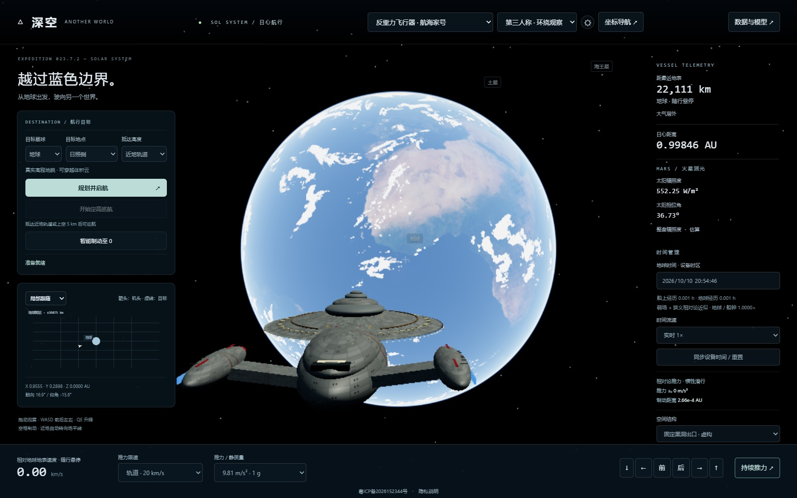

# 深空 · Deep Space

**从地球出发，去看看更远的世界。**

一场献给太空探索爱好者的 3D 网页旅行。  
飞过行星的地平线，驶向遥远星空，感受在宇宙中自由探索的快乐。

### [🚀 立即启航 · virtualexplore.online](https://virtualexplore.online/)

无需注册，无需安装，打开浏览器即可体验。

网站实际运行截图 · 点击图片，开启你的太空旅行

## 你的旅程

- **游历太阳系**：告别蓝色地球，探访月球、火星与土星的壮丽星环。
- **选择飞行方式**：驾驶反重力或核动力飞船，切换第一、第三人称视角，欣赏星球与飞船。
- **探索星际世界**：穿越球形虫洞，接近黑洞，在米勒星球的海面迎接电影灵感的巨浪。

## 开始探索

选择目标星球、地点与抵达高度，点击 **「规划并启航」**。初次体验可使用默认的反重力飞船。

鼠标拖动观察 · **W / A / S / D** 移动 · **Q / E** 升降 · **空格** 制动

推荐使用电脑浏览器体验。首次加载需下载地形与纹理，请留意页面上的加载进度。

> 深空融合天文数据与科幻设定，部分视觉与物理过程作了简化；反重力、超光速及虫洞等包含虚构设计。相关说明可在网站的「数据与模型」中查看。

---

**下一站，由你决定。**

[进入深空 →](https://virtualexplore.online/)

如果喜欢这段旅程，欢迎点亮 Star，分享给同样热爱星空的朋友。

